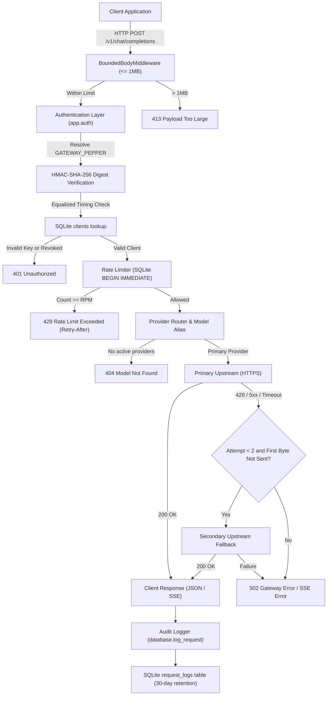

# Architecture & Request Lifecycle

## Overview

AI Gateway V1 is a lightweight, zero-trust reverse proxy designed to expose a secure OpenAI-compatible interface backed by SQLite and FastAPI.

## Request Flow Diagram

## Core Modules

- `app.main`: FastAPI application factory, routing, streaming loop, and error handling.
- `app.auth`: Key generation (`secrets`), HMAC verification with constant-time dummy comparison for missing clients, and log payload preparation.
- `app.database`: SQLite connection management (WAL, FULL sync, 5s busy timeout), atomic rate limiting, schema migrations (`PRAGMA user_version`), and live backup.
- `app.config`: YAML schema loading, environment variable overrides, strict model and provider key allowlisting.
- `app.ssrf`: Canonical URL validation, rejection of forbidden IP spaces (RFC 1918, RFC 3927 metadata, RFC 6598 CGNAT, RFC 1122 loopback), and DNS rebinding prevention via IP-pinned network transport.
- `app.providers`: Upstream HTTP communication, retryable fallback loop, stream forwarding, and response size capping.
- `app.secret_loader`: Sanitized secret loader supporting direct environment variables or file-based secrets with strict permission verification.
- `app.admin`: Local management CLI for client creation, revocation, usage auditing, and database backup.
